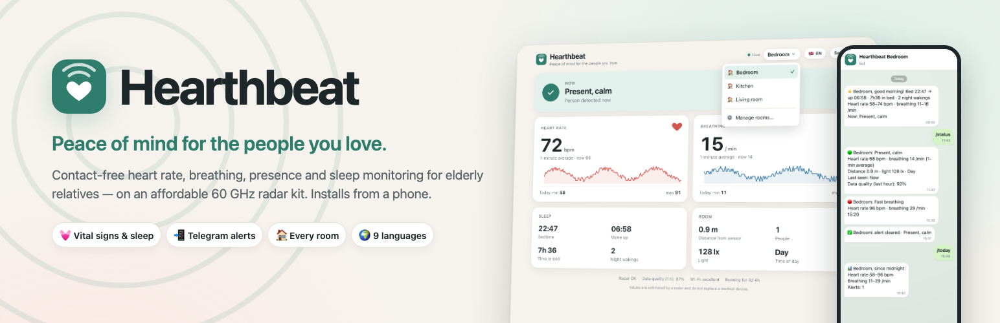
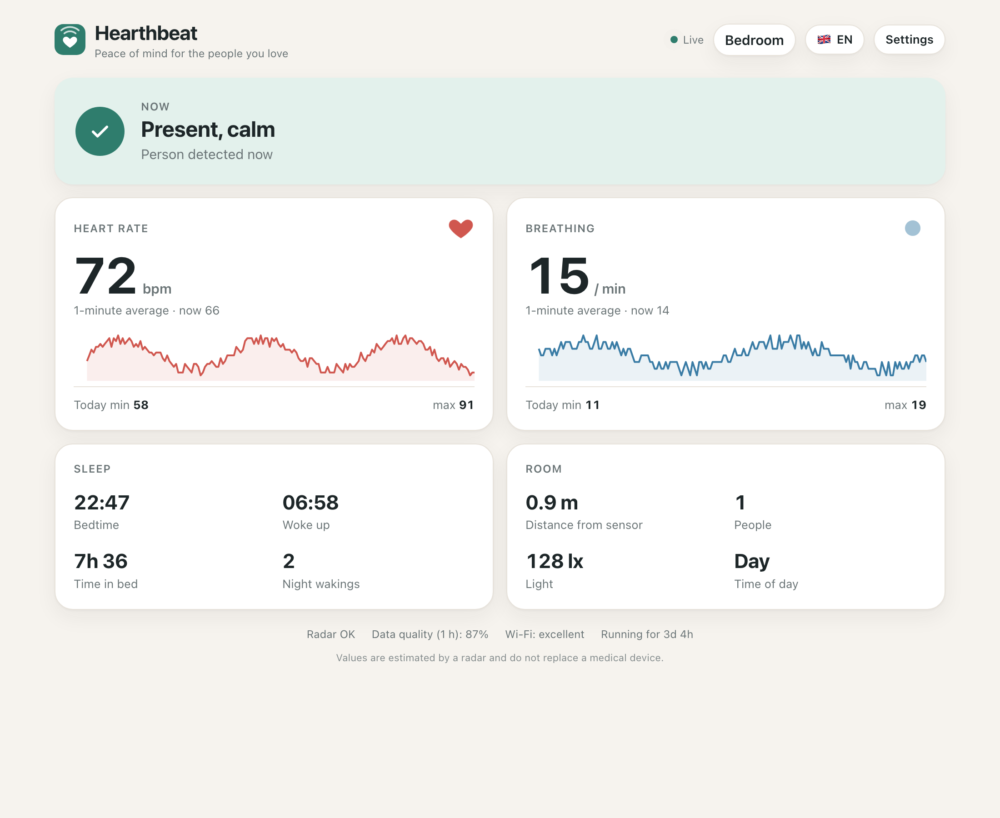
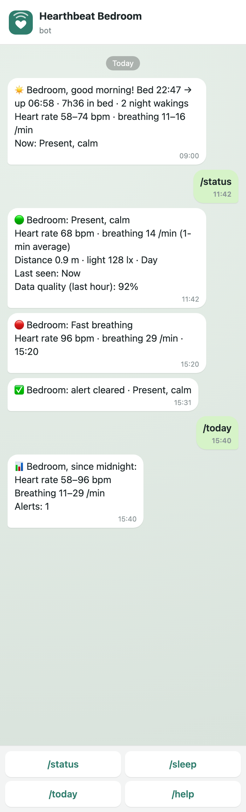
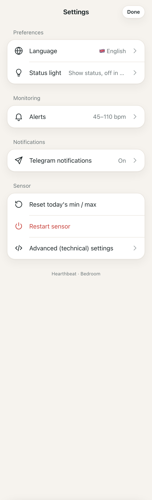
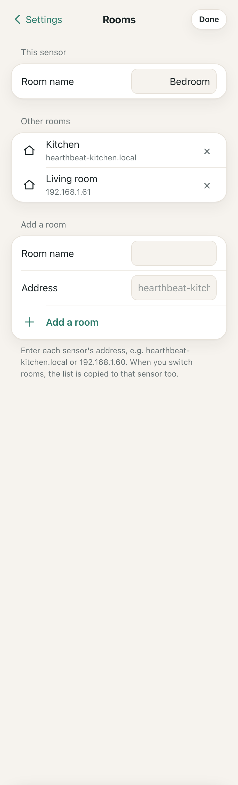
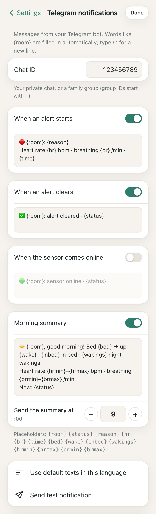
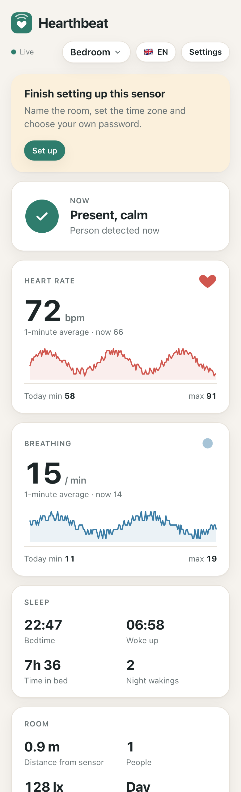
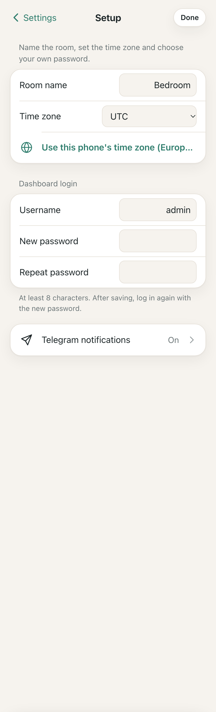
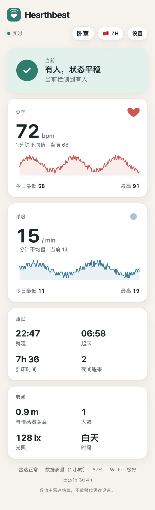
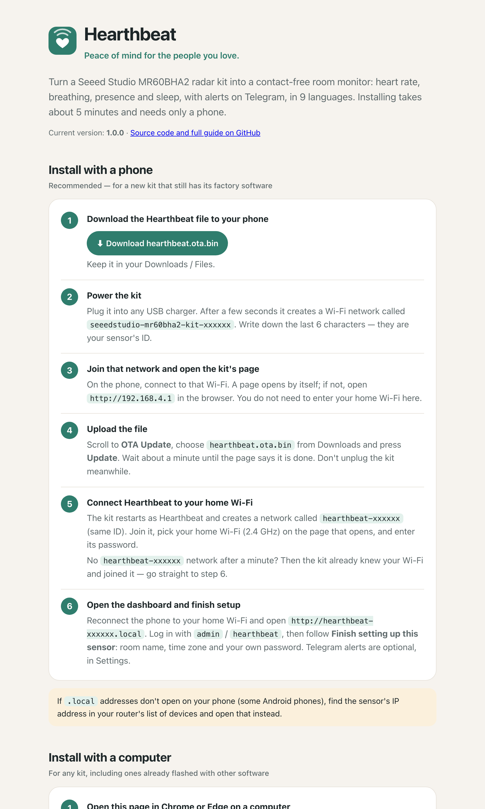

<p align="center">
  
</p>

<h1 align="center">Hearthbeat</h1>

<p align="center">
  <strong>Peace of mind for the people you love.</strong>
</p>

<p align="center">
  Open-source firmware and dashboard that turn a small 60 GHz radar kit into a contact-free room monitor<br />
  for elderly relatives: heart rate, breathing, presence and sleep, with Telegram alerts, in 9 languages —<br />
  no wearables, no cameras, nothing to charge, and it installs from a phone.
</p>

<p align="center">
  
  
  
  
  
  
</p>

<p align="center">
  <a href="https://costibotez.github.io/hearthbeat/"><strong>📲 Install from your phone</strong></a> ·
  <a href="#what-you-get">Features</a> ·
  <a href="#screenshots">Screenshots</a> ·
  <a href="#-telegram-notifications">Telegram</a> ·
  <a href="#-several-rooms">Rooms</a> ·
  <a href="#%EF%B8%8F-build-it-yourself">Build it yourself</a> ·
  <a href="#troubleshooting">Troubleshooting</a> ·
  <a href="#development">Development</a>
</p>

<p align="center">
  Author: <a href="https://www.nomad-developer.co.uk/">Costin Botez</a> (<a href="https://www.instagram.com/costinbotez/">@costinbotez</a>) ·
  <a href="https://www.nomad-developer.co.uk/">Portfolio</a> ·
  <a href="https://www.instagram.com/costinbotez/">Instagram</a> ·
  <a href="https://github.com/costibotez">GitHub</a>
</p>

---

## Why Hearthbeat exists

When your parents or grandparents live on their own and you live far away, the question is always the same: *are they OK right now?* Wearables get forgotten on the nightstand, cameras feel like an intrusion, and medical monitors are expensive.

Hearthbeat answers that question with a small radar sensor in each room. It sees through blankets but not through privacy: there are **no images and no audio**, only numbers. You open one page — or ask on Telegram — and see, at a glance:

- 💚 **"Present, calm"** — or a clear red **"Attention: fast breathing"** when something needs a look
- 💓 Heart rate and 🌬️ breathing, live and as 1-minute averages, with today's range
- 🌙 When they went to bed, when they got up, and how many times they got up in the night
- 🏠 Every room in the home, one tap apart

> [!IMPORTANT]
> Hearthbeat is a peace-of-mind tool, **not a medical device**. Radar readings are estimates, they only work when the person is still and close to the sensor, and they must never replace professional care, a fall alarm or an emergency plan.

## ⚡ Quick start

| You have… | Do this |
|---|---|
| **A new Seeed MR60BHA2 kit and a phone** | Open **[costibotez.github.io/hearthbeat](https://costibotez.github.io/hearthbeat/)** and follow the 6 steps — download a file, join the kit's Wi-Fi, upload. No computer, no code. |
| **A computer with Chrome or Edge** | Same page → **Install Hearthbeat over USB**. |
| **ESPHome experience** and want your own build | See [Build it yourself](#%EF%B8%8F-build-it-yourself). |

After installing, open `http://hearthbeat-xxxxxx.local` (the ID is printed on the kit's Wi-Fi name), log in with `admin` / `hearthbeat`, and the dashboard walks you through **room name, time zone and your own password**.

## What you get

### 💓 Vital signs
- Live **heart rate** and **breathing rate** from the 60 GHz radar, plus **1-minute averages** that smooth out the jumps
- **Today's minimum and maximum**, reset at midnight
- **Stillness detection**: vital signs only count once the person has been still for 2 minutes (or is in bed). Walking, talking or working nearby shows *Present, moving* instead of a false alarm
- **Data quality** score: the share of the last hour with a usable reading
- Readings are ignored while a **second person** is in the room (visits) or the person is **too far** from the sensor

### 🔔 Alerts
- Plain-language status line: *Present, calm* · *Present, moving* · *In bed, resting* · *Visitor present* · *Too far for vital signs* · *Nobody in the room*
- Alerts for **fast or slow breathing**, **high or low heart rate**, **nobody seen for too long** and **radar not responding**
- Heart-rate and breathing alerts only fire while the person is **still or in bed**, and only after the condition lasts **one minute**
- All thresholds are editable in **Settings → Alerts** and survive restarts

### 📲 Telegram, straight from the sensor
- **Notifications**: alert started, alert cleared, sensor back online (a sign of a power or internet cut) and a **morning summary** of the night — each with its own switch and **editable message**, with ready-made texts in all 9 languages
- **Chat with the sensor**: send `/status`, `/sleep` or `/today` and it replies within seconds
- No hub and no cloud account — just a free Telegram bot. The token is set in the app and never shown again

### 🌙 Sleep
- **Bedtime** and **wake-up time**, detected from presence, distance and darkness
- **Time in bed** and **night wakings** (out of the room for 2+ minutes)

### 🏠 Several rooms
- **Room switcher** in the dashboard header to jump between the sensors in the home
- **Name or rename a room** in the app (Settings → Rooms) — e.g. when a sensor moves or a new one arrives
- **Add a sensor** from the room switcher. Give each room a name and emoji, then use **Home overview** to see when its sensor last checked in.

### 🌍 A dashboard anyone can use
- Calm, phone-first dashboard served **by the sensor itself** — no app store, no account, no cloud
- **English, Română, 中文, हिन्दी, Español, Français, Português, Русский, Deutsch**, with a flag selector; follows the phone's language
- Light and dark mode, animated heart and breathing indicators, 15-minute sparklines
- **Settings** grouped like a phone's settings app (Preferences, Monitoring, Notifications, Sensor), one **Save** bar

### 🛠 Installs and updates without a computer
- **Install from a phone** through the kit's own Wi-Fi, or over USB from the [install page](https://costibotez.github.io/hearthbeat/)
- **First-run setup** in the app: room, time zone (detected from your phone), your own password
- **Software updates** appear in Settings → Software update — one tap installs them
- Works with **Home Assistant** (auto-discovered) for history, automations and Alexa — encrypted with a key each sensor creates for itself
- **Check for updates** any time from Settings → Software update

### 💡 Status light
- The kit's RGB LED shows **green** (present and close), **yellow** (too far / visitor / moving), **red** (alert), or stays off when the room is empty
- Choose *always on*, *off in the dark*, *always off* or *manual*

## Screenshots

| Dashboard with the room switcher | An alert, in dark mode |
|---|---|
|  |  |

| Telegram: alerts, morning summary and `/status` | Settings, Rooms and Telegram |
|---|---|
|  |    |

| First-time setup in the app | In any of 9 languages |
|---|---|
|   |    |

| The install page — phone or USB |
|---|
|  |

## What you need

| Item | Notes |
|---|---|
| **Seeed Studio MR60BHA2 kit** (one per room) | XIAO ESP32-C6 + MR60BHA2 60 GHz breathing/heartbeat radar + BH1750 light sensor + RGB LED, in one small case |
| **A good USB power adapter** (5 V, 1 A or more) per sensor | Cheap adapters cause noisy readings. Sensors are mains-powered; batteries last only a day or two |
| **2.4 GHz Wi-Fi** | The ESP32-C6 does not use 5 GHz networks |
| **A phone** | For installing and for the dashboard. A computer is optional |
| *Optional:* a **Telegram** account | For alerts and chat on your phone, anywhere |
| *Optional:* **Home Assistant** | For history graphs, automations and Alexa |

## 📲 Installing from a phone

The full guide, with download links, is on the **[install page](https://costibotez.github.io/hearthbeat/)**. In short:

1. **Download** `hearthbeat.ota.bin` to your phone.
2. **Power the kit** with any USB charger. Look for a Wi-Fi network starting with `seeedstudio-mr60bha2`.
3. **Join that network**; the kit's page opens (or go to `http://192.168.4.1`).
4. In **OTA Update**, choose the file and press **Update**. Wait about a minute.
5. The kit restarts as Hearthbeat with a network called `hearthbeat-xxxxxx`. **Join it and choose your home Wi-Fi.**
6. Back on your home Wi-Fi, open **`http://hearthbeat-xxxxxx.local`**, log in with `admin` / `hearthbeat` and tap **Finish setting up this sensor**.

> Installing replaces Seeed's factory firmware. You can restore it any time from Seeed's [web flasher](https://limengdu.github.io/MR60BHA2_ESPHome_external_components).

**Updates** arrive by themselves: each sensor checks for a new version every 6 hours, and **Settings → Software update** installs it with one tap.

## Placement for good readings

- Mount the sensor **1–1.5 m from where the person rests** (bed, armchair), at chest height or slightly above, **facing them**.
- Heart rate and breathing need the person to be **still**. While they walk, talk or work nearby the dashboard shows *Present, moving* and pauses vital-sign alerts — that's expected.
- Avoid moving curtains, fans and plants, and large mirrors, metal or glass in the radar's view.
- Readings settle after about **60 seconds** of stillness.

## 📲 Telegram notifications

The sensor can message you, or a family group, on Telegram by itself:

| Notification | When | Default message |
|---|---|---|
| Alert started | An alert has lasted one minute | 🔴 `Bedroom: Fast breathing` + heart rate, breathing and time |
| Alert cleared | The alert is over | ✅ `Bedroom: alert cleared · Present, calm` |
| Sensor online | After every start-up — a sign there was a power or internet cut | 🟢 `Bedroom: sensor online · Present, calm` |
| Morning summary | Every morning at the chosen hour (default 09:00) | ☀️ `Bedroom, good morning! Bed 22:47 → up 06:58 · 7h36 in bed · 2 night wakings…` |

**Set-up (about 5 minutes):**

1. In Telegram, open **@BotFather**, send `/newbot`, choose a name and a username ending in `bot`, and copy the **token**.
2. Open your new bot and press **Start**. For family alerts, create a group, add the bot and send a message in the group.
3. Find the chat ID: open `https://api.telegram.org/bot<TOKEN>/getUpdates` in a browser and look for `"chat":{"id":…`. Group IDs start with `-`.
4. On the dashboard, open **Settings → Telegram notifications**, paste the **bot token** and **chat ID**, and press **Save**.
5. Press **Send test notification**.

Each notification has its own switch and editable message. **Use default texts in this language** fills in ready-made messages in any of the 9 languages. These placeholders are filled in when a message is sent; type `\n` for a line break:

| Placeholder | Value | Placeholder | Value |
|---|---|---|---|
| `{room}` | Room name | `{bed}` / `{wake}` | Last bedtime / wake-up time |
| `{status}` | Status line, e.g. *Present, calm* | `{inbed}` | Time in bed, e.g. *7h36* |
| `{reason}` | Alert reason, e.g. *Fast breathing* | `{wakings}` | Night wakings |
| `{hr}` / `{br}` | 1-minute heart rate / breathing | `{hrmin}` `{hrmax}` | Heart-rate range since midnight |
| `{time}` | Current time | `{brmin}` `{brmax}` | Breathing range since midnight |

`{status}` and `{reason}` come from the sensor in English. The token is stored on the sensor and shown as `********`. Messages travel through Telegram's servers and are not end-to-end encrypted.

### 💬 Chat with the sensor

Send a command to the bot and the sensor replies within about 10 seconds. The commands also appear as tap buttons and in Telegram's `/` menu.

| Command | Reply |
|---|---|
| `/status` | 🟢 `Bedroom: Present, calm` · heart rate and breathing · distance, light, time of day · last seen · data quality |
| `/sleep` | 🌙 Last night: bedtime → wake-up, time in bed, night wakings (or "in bed since…") |
| `/today` | 📊 Heart-rate and breathing ranges since midnight, number of alerts today |
| `/help` | The list of commands, with tap buttons |

The sensor only answers the configured chat. Commands can be switched off under **Settings → Telegram notifications → Reply to chat commands**.

> [!TIP]
> **Use one bot per room.** Each bot has a single message queue, so two sensors sharing a bot would take each other's commands. Create a bot per room (e.g. *Hearthbeat Bedroom*, *Hearthbeat Kitchen*), add them all to one family group, and `/status` gets an answer from every room.

> [!NOTE]
> Notifications need the home's internet. If power or internet drops, no alert can be sent — the 🟢 *online* message when it comes back tells you something happened.

## 🏠 Several rooms

- Install each kit the same way. Each gets its own address, `hearthbeat-xxxxxx.local`, shown in **Settings → Rooms**.
- Connect the new sensor to the same home Wi-Fi. Open the room switcher on an existing sensor and choose **Add a sensor**. Match its six-character ID, enter a room name, choose an emoji, and confirm with **Add a sensor**.
- Use **Enter address manually** for older firmware or if the network blocks discovery. For a compatible Seeed kit that still needs Hearthbeat, follow the **Install Hearthbeat** link.
- The **Home overview** checks registered sensors while you view it. It remembers their most recent Wi-Fi check-in in this browser and opens each room’s dashboard when selected.
- Discovered rooms show their installed Hearthbeat release and update status. When **Update to …** appears, select it to open that sensor's **Software update** control and confirm the installation.

Device setup labels can link to `https://costibotez.github.io/hearthbeat/?id=b44a68#setup` with the unit’s six-character ID. The setup page fills in the matching hotspot and dashboard address.
- The list is stored on the sensor and copied to each sensor as you switch rooms, so you only add each room once.
- Rename a room at any time in **Settings → Rooms**; the name is used on the dashboard and in Telegram.

## 🌍 Seeing it from anywhere

- **Telegram** is the easiest way to keep an eye on things from abroad: alerts arrive by themselves and `/status` answers any time.
- The dashboard is meant for the home network. **Do not expose it to the internet with port forwarding** — it uses plain HTTP with a basic password.
- For the full dashboard and history from anywhere, add **Home Assistant** at the home (a Home Assistant Green or a Raspberry Pi): sensors are discovered under **Settings → Devices & services → ESPHome** — enter the **Home Assistant key** shown in the dashboard under **Settings → Setup** (each sensor creates its own on first start); reach it remotely with **Home Assistant Cloud** or **Tailscale**. Home Assistant also connects to **Amazon Alexa**.

## Logging readings to a file

Every 10 seconds the sensor writes a CSV line (`time, breaths/min, heart rate, distance cm`) to its log — handy for comparing with a pulse oximeter:

```bash
curl -s -N -u 'admin:YOUR_PASSWORD' http://hearthbeat-xxxxxx.local/events | grep --line-buffered -o 'CSV,[0-9:,.na-]*' | tee readings.csv
```

## 🛠️ Build it yourself

For ESPHome users who want their own build, with Wi-Fi and passwords compiled in from `secrets.yaml`.

### 1. Install ESPHome

```bash
python3 -m venv ~/esphome-venv
source ~/esphome-venv/bin/activate
pip install esphome
```

### 2. Get the code and fill in your secrets

```bash
git clone https://github.com/costibotez/hearthbeat.git && cd hearthbeat
cp secrets.example.yaml secrets.yaml      # Wi-Fi, dashboard login, OTA password
openssl rand -base64 32                   # paste as api_encryption_key
```

> [!WARNING]
> The ESP32-C6 toolchain **cannot build in a folder whose path contains spaces**. Clone into a path without spaces, or set `build_dir` in your room file (see `example-room.yaml`).

### 3. Create a file per room

```bash
cp example-room.yaml hearthbeat-bedroom.yaml
```

```yaml
substitutions:
  name: hearthbeat-bedroom        # → http://hearthbeat-bedroom.local
  room: Bedroom                   # starting name; can be changed in the app
  timezone: Europe/London         # the home's time zone

packages:
  base: !include hearthbeat-base.yaml
  personal: !include hearthbeat-personal.yaml    # Wi-Fi and passwords from secrets.yaml
  # telegram: !include hearthbeat-telegram.yaml  # optional
```

Your room files (`hearthbeat-*.yaml`) are ignored by git.

### 4. Flash

```bash
esphome run hearthbeat-bedroom.yaml
```

The first build takes 5–10 minutes. Pick the `/dev/cu.usbmodem…` (macOS), `/dev/ttyACM0` (Linux) or `COM3` (Windows) port; hold **BOOT** while plugging in if the board doesn't appear. Later updates go over Wi-Fi with the same command.

> [!NOTE]
> The sensor only accepts updates signed with the `ota_password` it was built with. To change it, flash once over USB.

## Troubleshooting

<details>
<summary><strong>The kit's page has no "OTA Update" section</strong></summary>

Some kits ship with different factory software. Use **Install over USB** on the install page from a computer instead.
</details>

<details>
<summary><strong><code>hearthbeat-xxxxxx.local</code> doesn't open</strong></summary>

Some Android phones don't support <code>.local</code> addresses. Find the sensor in your router's list of connected devices and open its IP address instead.
</details>

<details>
<summary><strong>I forgot the dashboard password</strong></summary>

Reinstall over USB from the install page and choose <em>erase</em> when asked; the sensor starts fresh with <code>admin</code> / <code>hearthbeat</code>.
</details>

<details>
<summary><strong>The light turns red while I'm at my desk</strong></summary>

Red always means an alert; check <em>Alert reason</em> on the dashboard. Moving or talking makes the radar over-estimate breathing, so vital-sign alerts pause until the person has been still for 2 minutes. If you still get alerts while resting, adjust the thresholds in Settings → Alerts.
</details>

<details>
<summary><strong>"Detected a whitespace character in project paths"</strong></summary>

Your build folder path contains a space. Set <code>build_dir</code> in your room file to a path without spaces (for example <code>/Users/Shared/esphome-build</code> on macOS).
</details>

<details>
<summary><strong>The computer does not see the board over USB</strong></summary>

Almost always a charge-only cable. Try a cable you have used to transfer files, plug straight into the computer, and hold <strong>BOOT</strong> while plugging in.
</details>

<details>
<summary><strong>The chip temperature looks high</strong></summary>

50–65 °C is normal: the radar warms the small case. Worry only above about 80 °C.
</details>

## Roadmap

- Home Assistant blueprint for alerts across all rooms (e.g. "nobody seen anywhere by 10:00")
- Room position on a floor plan with an HLK-LD2450 tracking radar
- Temperature / humidity add-on and a help button
- Fall detection for bathrooms with the Seeed MR60FDA2
- Right-to-left layout and Arabic translation

Ideas and pull requests are welcome.

## Development

- **Firmware** is [ESPHome](https://esphome.io/) YAML in layers:
  - `hearthbeat-base.yaml` — everything shared: sensors, alerts, sleep, stillness, LED, rooms, web server. No secrets.
  - `hearthbeat-personal.yaml` — Wi-Fi, login, API key and OTA password from `secrets.yaml`, for your own builds.
  - `hearthbeat-generic.yaml` — the ready-made build: no secrets, unique `hearthbeat-xxxxxx` address, first-run setup, time zone and login set in the app, updates from the published manifest.
  - `hearthbeat-telegram.yaml` — optional Telegram add-on; network traffic runs in a background task (`hearthbeat_tg.h`) so the sensor never pauses.
- **Dashboard**: plain HTML/CSS/JS, no build step, embedded with ESPHome's `js_include` / `css_include` and fed by the sensor's `/events` stream. Settings are saved through ESPHome's REST API.
- **Translations** live in `www/hearthbeat.js`. To add a language, copy an `en` block in each table and add a row to `LANGS`.
- **Preview without hardware**: serve the repo and open the preview page with simulated data:

```bash
python3 -m http.server 8000
# http://localhost:8000/preview/?lang=en   (try &m=alert, &generic=1, &open=rooms, &view=settings&page=telegram)
```

### Publishing a release

```bash
BUILD_DIR=/path/without/spaces python3 tools/release.py 1.0.1 "What changed"
git add docs/firmware && git commit -m "Release 1.0.1" && git push
gh release create v1.0.1 docs/firmware/hearthbeat.*.bin --title "Hearthbeat 1.0.1" --notes "What changed"
```

GitHub Pages serves `docs/` at [costibotez.github.io/hearthbeat](https://costibotez.github.io/hearthbeat/): the install page, the firmware files and `manifest.json`, which every installed sensor checks for updates.

```
hearthbeat-base.yaml       Shared firmware (no secrets)
hearthbeat-personal.yaml   Your own build: Wi-Fi and passwords from secrets.yaml
hearthbeat-generic.yaml    Ready-made build for the install page
hearthbeat-telegram.yaml   Optional add-on: Telegram notifications and chat commands
hearthbeat_tg.h            Background Telegram sender
hearthbeat_fmt.h           Message template helper
hearthbeat_tz.h            Time zones for the ready-made build
example-room.yaml          Template for a room file (copy one per room)
secrets.example.yaml       Template for secrets.yaml
www/hearthbeat.js|css      Dashboard, settings and translations
preview/                   Dashboard preview with simulated data
tools/release.py           Builds the ready-made firmware and its manifest
docs/index.html            Install page (GitHub Pages)
docs/firmware/             Published firmware and manifest
docs/images/               Logo, banner and screenshots
```

## License

[MIT](LICENSE) — free to use, change and share. If Hearthbeat helps your family, a ⭐ on GitHub makes the author's day.
