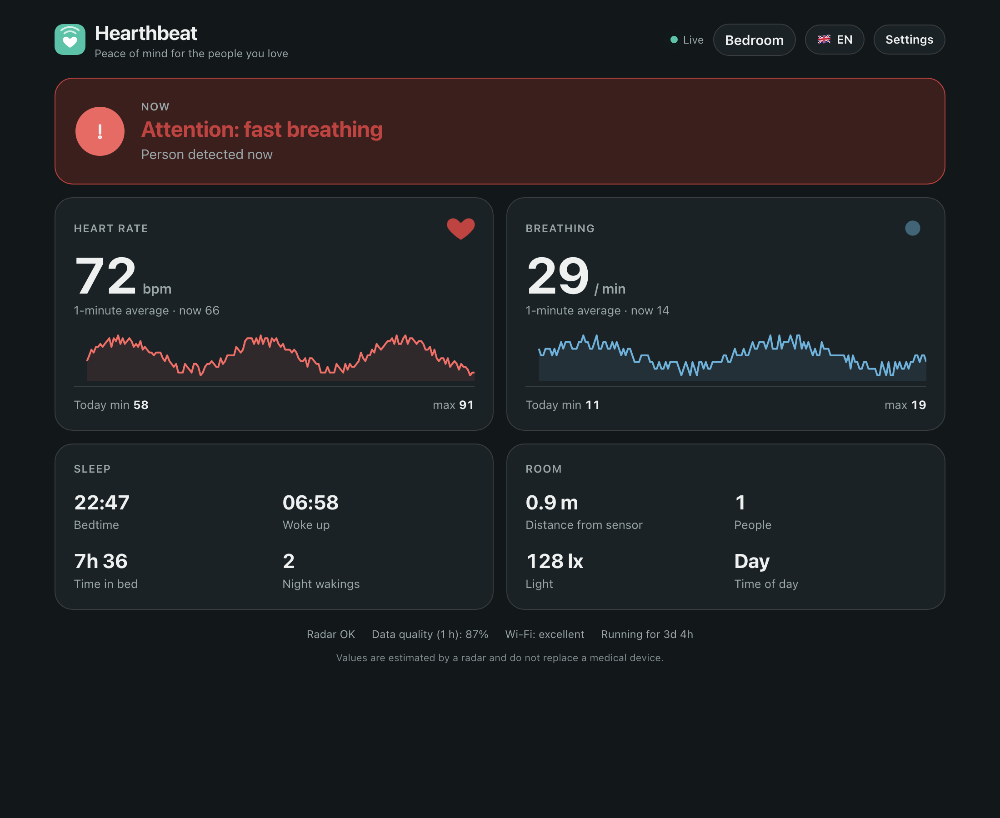
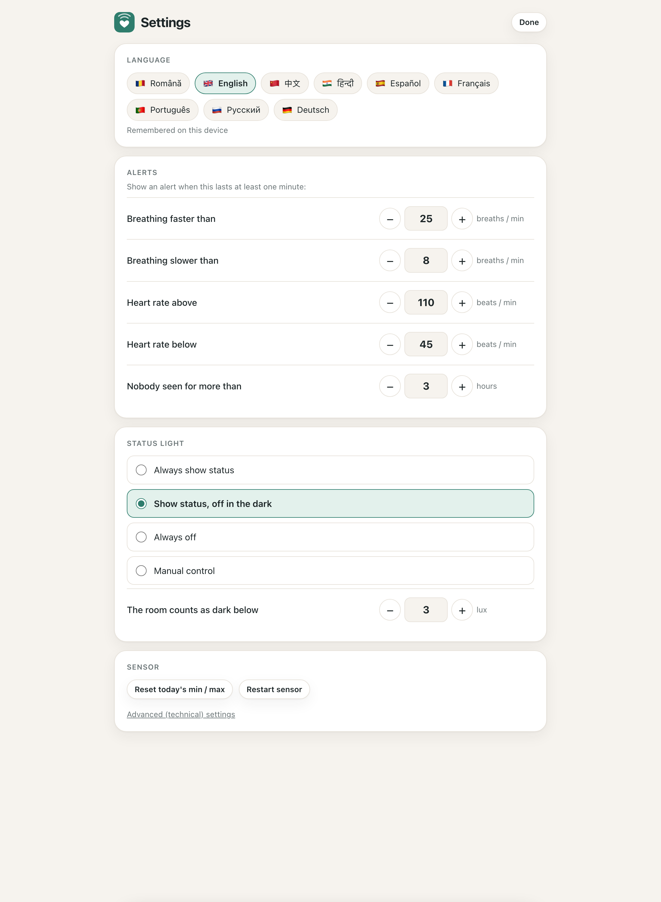
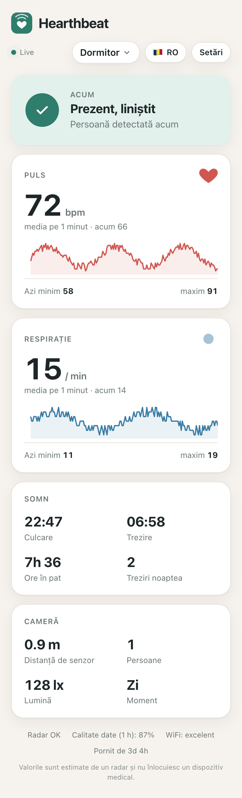
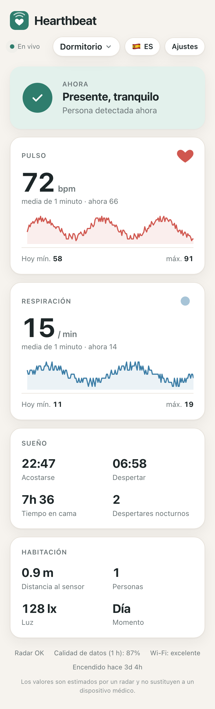

<p align="center">
  
</p>

<h1 align="center">Hearthbeat</h1>

<p align="center">
  <strong>Peace of mind for the people you love.</strong>
</p>

<p align="center">
  Open-source firmware and dashboard that turn a small 60 GHz radar kit into a contact-free room monitor<br />
  for elderly relatives: heart rate, breathing, presence and sleep, with alerts, in 9 languages —<br />
  no wearables, no cameras, and nothing to charge or remember.
</p>

<p align="center">
  
  
  
  
  
</p>

<p align="center">
  <a href="#-quick-start">Quick start</a> ·
  <a href="#what-you-get">Features</a> ·
  <a href="#screenshots">Screenshots</a> ·
  <a href="#-installation-step-by-step">Installation</a> ·
  <a href="#-telegram-notifications">Telegram</a> ·
  <a href="#-seeing-it-from-anywhere">Remote access</a> ·
  <a href="#troubleshooting">Troubleshooting</a> ·
  <a href="#development">Development</a>
</p>

<p align="center">
  Author: <a href="https://www.nomad-developer.co.uk/">Costin Botez</a> (<a href="https://www.instagram.com/costinbotez/">@costinbotez</a>) ·
  <a href="https://www.nomad-developer.co.uk/">Portfolio</a> ·
  <a href="https://www.instagram.com/costinbotez/">Instagram</a> ·
  <a href="https://github.com/costibotez">GitHub</a>
</p>

---

## Why Hearthbeat exists

When your parents or grandparents live on their own and you live far away, the question is always the same: *are they OK right now?* Wearables get forgotten on the nightstand, cameras feel like an intrusion, and medical monitors are expensive.

Hearthbeat answers that question with a small radar sensor in each room. It sees through blankets but not through privacy: there are **no images and no audio**, only numbers. You open one page and see, at a glance:

- 💚 **"Present, calm"** — or a clear red **"Attention: fast breathing"** when something needs a look
- 💓 Heart rate and 🌬️ breathing, live and as 1-minute averages, with today's range
- 🌙 When they went to bed, when they got up, and how many times they got up in the night

> [!IMPORTANT]
> Hearthbeat is a peace-of-mind tool, **not a medical device**. Radar readings are estimates, they only work when the person is still and close to the sensor, and they must never replace professional care, a fall alarm or an emergency plan.

## What you get

### 💓 Vital signs
- Live **heart rate** and **breathing rate** from the 60 GHz radar, plus **1-minute averages** that smooth out the jumps
- **Today's minimum and maximum**, reset at midnight
- **Data quality** score: the share of the last hour with a usable reading, so you know when to trust a strange value
- **Stillness detection**: vital signs only count once the person has been still for 2 minutes (or is in bed). Walking, talking or working nearby shows *Present, moving* instead of a false alarm
- Readings are ignored while a **second person** is in the room (visits) or the person is **too far** from the sensor

### 🔔 Alerts
- Plain-language status line: *Present, calm* · *Present, moving* · *In bed, resting* · *Visitor present* · *Too far for vital signs* · *Nobody in the room*
- Alerts for **fast or slow breathing**, **high or low heart rate**, **nobody seen for too long** and **radar not responding**
- Heart-rate and breathing alerts only fire while the person is **still or in bed**, and only after the condition lasts **one minute**
- All thresholds are editable from the **Settings** page and survive restarts
- Optional **Telegram notifications** straight from the sensor — no hub, no cloud account: alert started, alert cleared, sensor back online, and a morning summary of the night

### 🌙 Sleep
- **Bedtime** and **wake-up time**, detected from presence, distance and darkness
- **Time in bed** and **night wakings** (out of the room for 2+ minutes)

### 💡 Status light
- The kit's RGB LED shows **green** (present and close), **yellow** (too far / visitor), **red** (alert), or stays off when the room is empty
- Choose *always on*, *off in the dark*, *always off* or *manual*

### 🌍 Friendly dashboard, 9 languages
- A calm, phone-first dashboard served **by the sensor itself** — no app, no account, no cloud
- **English, Română, 中文, हिन्दी, Español, Français, Português, Русский, Deutsch**, with a flag selector; follows the browser's language automatically
- Light and dark mode, animated heart and breathing indicators, 15-minute sparklines
- A friendly **Settings** page with a **Save** button; the full technical ESPHome page is one link away

### 🏠 Ready for more rooms and Home Assistant
- One shared firmware file, one tiny file per room
- Encrypted **Home Assistant** API built in, for phone notifications, history graphs and remote access
- **Updates over Wi-Fi** after the first install

## Screenshots

| Dashboard | Alert (dark mode) |
|---|---|
|  |  |

| Settings | On a phone, in any language |
|---|---|
|  |    |

## What you need

| Item | Notes |
|---|---|
| **Seeed Studio MR60BHA2 kit** (one per room) | XIAO ESP32-C6 + MR60BHA2 60 GHz breathing/heartbeat radar + BH1750 light sensor + RGB LED, in one small case |
| **USB-C cable that carries data** | Only for the first install. Many cables are charge-only; if your computer does not see the board, try another cable |
| **A good USB power adapter** (5 V, 1 A or more) per sensor | Cheap adapters cause noisy readings. Sensors are mains-powered; batteries last only a day or two |
| **2.4 GHz Wi-Fi** | The ESP32-C6 does not use 5 GHz networks |
| A computer with **Python 3.10+** | macOS, Linux or Windows |
| *Optional:* **Home Assistant** (e.g. Home Assistant Green) | For phone alerts, history and access from anywhere |

## ⚡ Quick start

If you already use ESPHome:

```bash
git clone https://github.com/costibotez/hearthbeat.git && cd hearthbeat
cp secrets.example.yaml secrets.yaml        # fill in Wi-Fi and passwords
cp example-room.yaml hearthbeat-bedroom.yaml     # set name, room, timezone
esphome run hearthbeat-bedroom.yaml
```

Then open `http://hearthbeat-bedroom.local` and log in with your `web_username` / `web_password`.

## 🛠 Installation, step by step

### 1. Install ESPHome (once)

```bash
python3 -m venv ~/esphome-venv
source ~/esphome-venv/bin/activate      # Windows: %USERPROFILE%\esphome-venv\Scripts\activate
pip install esphome
```

### 2. Download Hearthbeat

```bash
git clone https://github.com/costibotez/hearthbeat.git
cd hearthbeat
```

> [!WARNING]
> The ESP32-C6 toolchain **cannot build in a folder whose path contains spaces** (for example `~/My Projects/`). Either clone into a path without spaces, or set `build_dir` in your room file to one, as `example-room.yaml` shows.

### 3. Fill in your secrets

```bash
cp secrets.example.yaml secrets.yaml
openssl rand -base64 32                 # paste the result as api_encryption_key
```

Edit `secrets.yaml`: your Wi-Fi name and password, a password for the fallback hotspot, the dashboard login, an update (OTA) password and the API key. `secrets.yaml` is ignored by git, so it never ends up on GitHub.

### 4. Create a file for each room

```bash
cp example-room.yaml hearthbeat-bedroom.yaml
```

```yaml
substitutions:
  name: hearthbeat-bedroom        # lowercase, no spaces, unique on your network → http://hearthbeat-bedroom.local
  room: Bedroom                   # shown on the dashboard and in notifications
  timezone: Europe/London         # the home's time zone, used for sleep times and daily resets
  # build_dir: /Users/Shared/esphome-build   # only if your folder path has spaces

packages:
  base: !include hearthbeat-base.yaml
  # telegram: !include hearthbeat-telegram.yaml   # optional, see Telegram notifications
```

Your room files (`hearthbeat-*.yaml`) are ignored by git, so your own settings stay on your computer.

### 5. Install the firmware (first time)

**Option A — over USB (recommended)**

```bash
source ~/esphome-venv/bin/activate
esphome run hearthbeat-bedroom.yaml
```

The first build downloads the toolchain and takes 5–10 minutes. When asked for the port, pick the one that looks like `/dev/cu.usbmodem…` (macOS), `/dev/ttyACM0` (Linux) or `COM3` (Windows). If the board does not appear, hold the **BOOT** button while plugging it in.

**Option B — over Wi-Fi, if the kit still runs Seeed's factory firmware**

1. Power the kit. It creates a hotspot named like `seeedstudio-mr60bha2-kit-xxxxxx`.
2. Join it from your phone, open **http://192.168.4.1**, choose your 2.4 GHz Wi-Fi and enter its password.
3. Find the kit's IP address in your router (or with `ping seeedstudio-mr60bha2-kit-xxxxxx.local`) and run:

```bash
esphome upload hearthbeat-bedroom.yaml --device 192.168.1.50
```

The factory firmware accepted the update without a password in our testing. If yours refuses, use option A.

> Flashing replaces the factory firmware. You can restore it any time from Seeed's [web flasher](https://limengdu.github.io/MR60BHA2_ESPHome_external_components).

### 6. Open the dashboard

Go to **`http://<name>.local`** (for example `http://hearthbeat-bedroom.local`) and log in. If `.local` names don't work on your network, use the IP address from your router.

### 7. Future updates

Every later update goes over Wi-Fi, from anywhere on the same network:

```bash
esphome run hearthbeat-bedroom.yaml
```

> [!NOTE]
> The sensor only accepts updates signed with the `ota_password` it was built with. If you change that password in `secrets.yaml`, the next upload will be refused: flash once over USB, or see [Changing passwords](#changing-passwords).

## 📲 Telegram notifications

The sensor can message you (or a family group) on Telegram by itself — no Home Assistant needed:

| Message | When |
|---|---|
| 🔴 `Bedroom: Fast breathing` + latest heart rate and breathing | An alert has lasted one minute |
| ✅ `Bedroom: alert cleared (Present, calm)` | The alert is over |
| 🟢 `Bedroom: sensor online` | After every start-up — a sign there was a power or internet cut |
| ☀️ `Bedroom, good morning. Bed 22:47 → up 06:58, 7h36 in bed, 2 night wakings…` | Every morning at `summary_hour` (default 09:00) |

**Set-up (about 5 minutes):**

1. In Telegram, open **@BotFather**, send `/newbot`, choose a name and a username ending in `bot`. Copy the **token** it gives you (keep it secret — it controls the bot).
2. Open your new bot and press **Start**. For family alerts, create a group, add the bot and send a message in the group.
3. Find the chat ID: open `https://api.telegram.org/bot<TOKEN>/getUpdates` in a browser and look for `"chat":{"id":…`. Group IDs start with `-`.
4. Add both to `secrets.yaml`:
   ```yaml
   telegram_bot_token: "1234567890:AA..."
   telegram_chat_id: "123456789"
   ```
5. In your room file, uncomment `telegram: !include hearthbeat-telegram.yaml`, then `esphome run` it.
6. Press **Settings → Send test notification** on the dashboard.

To change the summary time, add `summary_hour: "8"` to your room file's `substitutions`. Messages travel through Telegram's servers and are not end-to-end encrypted.

> [!NOTE]
> Notifications need the home's internet. If power or internet drops, no alert can be sent — the 🟢 *online* message when it comes back tells you something happened. For a warning *while* the home is offline, use Home Assistant Cloud or an external uptime monitor.

## 🌍 Seeing it from anywhere

The dashboard is meant for the home network. **Do not expose it to the internet with port forwarding** — it uses plain HTTP with a basic password.

For access from abroad, add **Home Assistant** at the home (a Home Assistant Green or a Raspberry Pi, plugged into the router with a cable):

1. Each sensor is discovered automatically under **Settings → Devices & services → ESPHome**. Enter the `api_encryption_key` from `secrets.yaml`.
2. Make it reachable remotely with **Home Assistant Cloud** (easiest, paid) or **Tailscale** (free).
3. Build phone notifications from the `Alert`, `Alert reason`, `Presence` and `Radar not responding` entities — for example *"nobody seen anywhere by 10:00"*.

Home Assistant also connects to **Amazon Alexa** (presence as motion sensors, spoken announcements) and keeps long-term history graphs, which the sensor itself has no room for.

## Placement for good readings

- Mount the sensor **1–1.5 m from where the person rests** (bed, armchair), at chest height or slightly above, **facing them**.
- Heart rate and breathing need the person to be **still**. Readings while walking, talking or working at a desk are unreliable — that's expected, not a fault.
- Avoid moving curtains, fans and plants, and large mirrors, metal or glass in the radar's view.
- Readings settle after about **60 seconds** of stillness.

## Logging readings to a file

Every 10 seconds the sensor writes a CSV line (`time, breaths/min, heart rate, distance cm`) to its log — handy for comparing with a pulse oximeter. From the folder with `secrets.yaml`:

```bash
U=$(awk -F': *' '/^web_username/{gsub(/"/,"",$2);print $2}' secrets.yaml); P=$(awk -F': *' '/^web_password/{gsub(/"/,"",$2);print $2}' secrets.yaml); curl -s -N -u "$U:$P" http://hearthbeat-bedroom.local/events | grep --line-buffered -o 'CSV,[0-9:,.na-]*' | tee readings.csv
```

`esphome logs hearthbeat-bedroom.yaml` works too.

## Troubleshooting

<details>
<summary><strong>"Detected a whitespace character in project paths"</strong></summary>

The build folder path contains a space. Set `build_dir` in your room file to a path without spaces (for example `/Users/Shared/esphome-build` on macOS).
</details>

<details>
<summary><strong>The computer does not see the board over USB</strong></summary>

Almost always a charge-only cable. Try a cable you have used to transfer files, plug straight into the computer (no hub), and hold <strong>BOOT</strong> while plugging in. On a Mac, accept the "Allow accessory to connect?" prompt.
</details>

<details>
<summary><strong>The light turns red while I'm at my desk</strong></summary>

Red always means an alert; check <em>Alert reason</em> on the dashboard. Moving or talking near the sensor makes the radar over-estimate breathing, so heart-rate and breathing alerts are paused until the person has been still for 2 minutes (the dashboard shows <em>Present, moving</em>). If you still get alerts while resting, adjust the thresholds in Settings.
</details>

<details>
<summary><strong id="changing-passwords">Changing passwords</strong></summary>

The dashboard password and Wi-Fi details change with the next upload. The <code>ota_password</code> is different: the sensor checks the <em>old</em> one before accepting new firmware. To change it over Wi-Fi, flash once with the old password in <code>secrets.yaml</code> plus an <code>on_boot</code> action calling <code>id(ota_main).set_auth_password("new")</code>, then switch <code>secrets.yaml</code> to the new password. Or simply flash over USB.
</details>

<details>
<summary><strong>The chip temperature looks high</strong></summary>

50–65 °C is normal: the radar warms the small case. Worry only above about 80 °C.
</details>

## Roadmap

- Home Assistant blueprint for alerts across all rooms (e.g. "nobody seen anywhere by 10:00")
- Room position on a floor plan with an HLK-LD2450 tracking radar
- Temperature / humidity add-on and a help button
- Fall detection for bathrooms with the Seeed MR60FDA2
- Right-to-left layout and Arabic translation

Ideas and pull requests are welcome.

## Development

- **Firmware:** [ESPHome](https://esphome.io/) YAML. `hearthbeat-base.yaml` holds everything; room files only set `name`, `room`, `timezone` and optionally `build_dir`. The C++ lambdas inside handle averages, alerts, sleep detection, data quality and the LED.
- **Dashboard:** plain HTML/CSS/JS with no build step and no dependencies, embedded into the firmware with ESPHome's `js_include` / `css_include` and fed by the sensor's `/events` stream. Settings are saved through ESPHome's REST API (`POST /number/<name>/set?value=…`).
- **Translations** live in `www/hearthbeat.js` (`T` for the dashboard, `TS` for the settings page). To add a language, copy the `en` block and add a row to `LANGS`.
- **Preview without hardware:** serve the repo and open the preview page, which feeds the dashboard simulated data:

```bash
python3 -m http.server 8000
# open http://localhost:8000/preview/?lang=en   (try &m=alert, &m=empty, &view=settings, &lang=de)
```

```
hearthbeat-base.yaml     Shared firmware: sensors, alerts, sleep tracking, LED, web server, API
hearthbeat-telegram.yaml Optional add-on: Telegram notifications
example-room.yaml        Template for a room file (copy one per room)
secrets.example.yaml     Template for secrets.yaml (Wi-Fi, passwords, API key)
www/hearthbeat.js        Dashboard + settings page + translations
www/hearthbeat.css       Dashboard styles (light and dark)
preview/index.html       Dashboard preview with simulated data
docs/images/             Logo, banner and screenshots
```

## License

[MIT](LICENSE) — free to use, change and share. If Hearthbeat helps your family, a ⭐ on GitHub makes the author's day.
